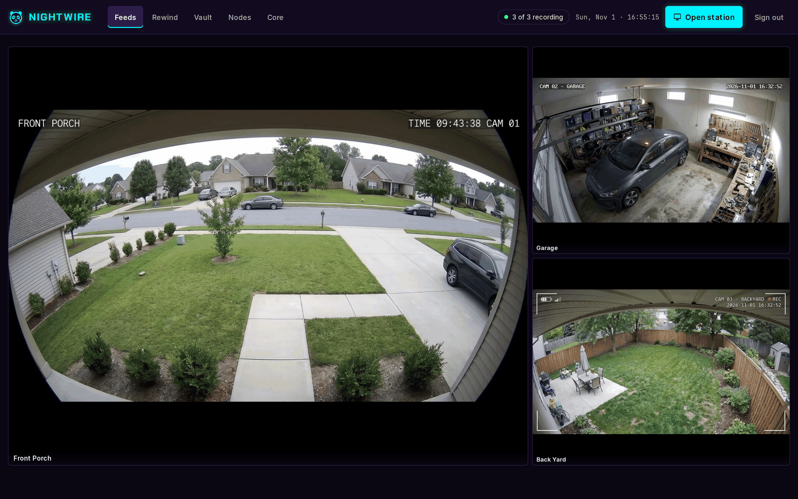
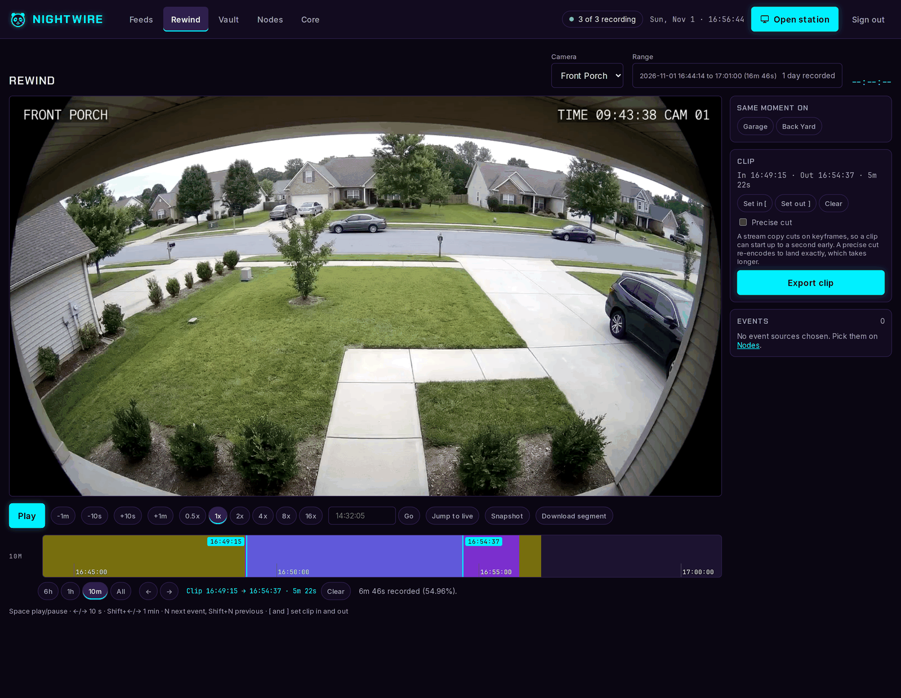
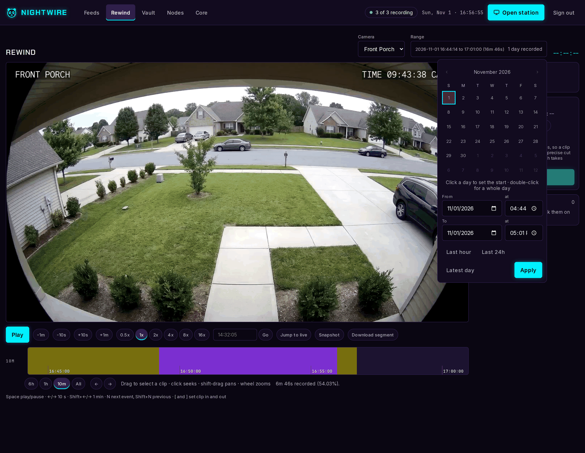
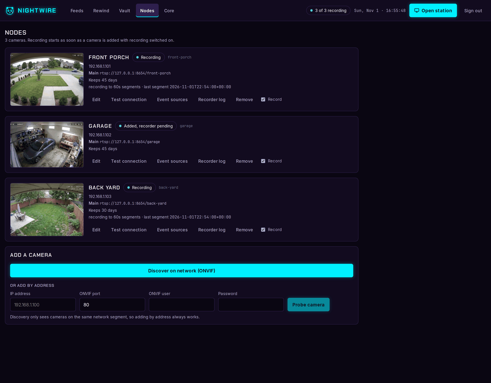
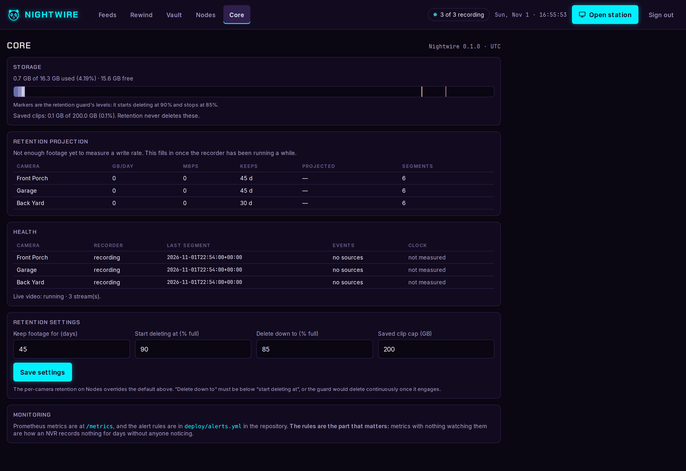
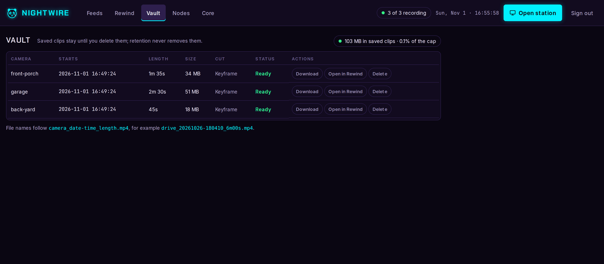
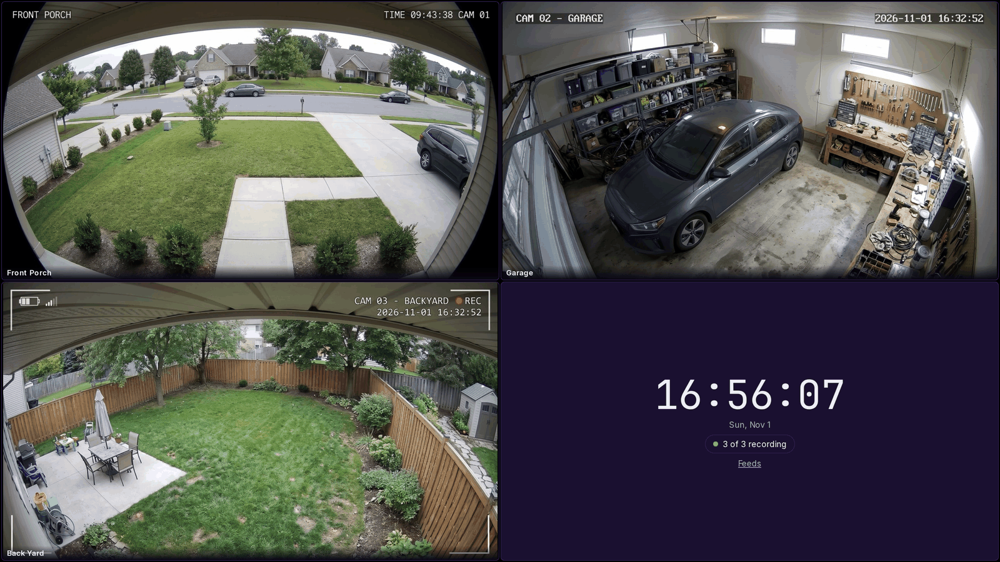

# Nightwire

A single-container, LAN-only network video recorder for ONVIF cameras.
Records 24/7 without re-encoding, and serves one web UI for live viewing,
timeline playback and clip export.

**Intended for any ONVIF-compatible camera; tested against an Axis camera.**
Nothing is hard-coded to a vendor - stream URIs, media profiles and event
topics are all read from the camera itself - but Axis is the only hardware
it has actually run against, so expect to find rough edges on others and
please report them.

- **Records** each camera's H.264 stream to 60-second segments with ffmpeg
  stream copy, so CPU stays low and the footage keeps the camera's quality.
- **Live view** over WebRTC with an MSE fallback, via a supervised go2rtc,
  including a configurable viewing-station layout for a wall screen.
- **Playback** of any day as an HLS VOD stream, with a zoomable timeline,
  hover thumbnails and deep links to a moment.
- **Motion events** read from the camera's own ONVIF event topics, corrected
  onto the NVR's clock, drawn as lanes on the timeline.
- **Clip export** cut from the recorded segments and kept in a vault that
  retention never deletes.
- **Retention** per camera by age, plus a disk guard that deletes oldest
  first before the volume fills.
- **Monitoring** through `/metrics` in Prometheus format, with alert rules in
  `deploy/alerts.yml`.

LAN only. One shared password, a session cookie, and no cloud, no account
and no outbound connection of any kind.

## Screenshots

Captured against synthetic sources: the camera views are generated images
looped as video, not footage from anyone's cameras.

| | |
| --- | --- |
| **Feeds** - live grid, one large tile and the rest beside it | **Rewind** - playback, with a clip selected by dragging the timeline |
| [](docs/screenshots/feeds.png) | [](docs/screenshots/rewind.png) |
| **Choosing a range** - start and end date and time, days with footage only | **Nodes** - cameras, status and adding one |
| [](docs/screenshots/rewind-range.png) | [](docs/screenshots/nodes.png) |
| **Core** - storage, retention projection and health | **Vault** - saved clips, which retention never deletes |
| [](docs/screenshots/core.png) | [](docs/screenshots/vault.png) |
| **Station** - a wall layout, configured by URL | |
| [](docs/screenshots/station.png) | |

## Requirements

- A host with Docker and roughly 2 GB of RAM.
- Local block storage for `/recordings`. **Not NFS**: a network blip becomes
  a recording gap, which is the failure this is built to avoid.
- One or more **ONVIF cameras** reachable over ONVIF (usually port 80 or
  443) and RTSP (554), each with an ONVIF user, serving H.264.

## Quick start

Running the published image, with no checkout and nothing to build:

```bash
mkdir nightwire && cd nightwire
curl -O https://raw.githubusercontent.com/ethicaltink/nightwire/main/compose.pull.yml
curl -o .env https://raw.githubusercontent.com/ethicaltink/nightwire/main/.env.example
```

Set `NVR_PASSWORD` and `NVR_SECRET_KEY` in `.env`; the app refuses to start
without them. Point the `/recordings` volume in `compose.pull.yml` at your
storage, then:

```bash
docker compose -f compose.pull.yml up -d
docker ps --filter name=nightwire      # expect (healthy) after ~20s
```

Open `http://<host>:8080` and sign in.

### Or build from source

```bash
git clone https://github.com/ethicaltink/nightwire && cd nightwire
cp .env.example .env
```

Generate a key with `openssl rand -hex 32`, then point `/recordings` at your
storage in `docker-compose.yml`:

```yaml
    volumes:
      - ./config:/config
      - /mnt/nvr-recordings:/recordings
```

Then:

```bash
docker compose up -d --build
docker ps --filter name=nightwire      # expect (healthy) after ~20s
```

Open `http://<host>:8080` and sign in. A fresh install reports healthy with
`recorders` in state `idle`, because there are no cameras yet:

```bash
curl -s localhost:8080/api/health | python3 -m json.tool
```

## Configuration

Everything is environment variables, set in `.env`.

| Variable | Default | What it does |
| --- | --- | --- |
| `NVR_PASSWORD` | *(required)* | The single shared UI password, minimum 8 characters |
| `NVR_SECRET_KEY` | *(required)* | Encrypts camera passwords at rest and keys sessions, minimum 32 characters |
| `NVR_PORT` | `8080` | Port the UI and API listen on |
| `TZ` | `UTC` | Display time zone. Everything is stored in UTC |
| `PUID` / `PGID` | `1000` | Owner applied to `/config` and `/recordings` before privileges are dropped |
| `NVR_LOG_FORMAT` | `human` | `json` for one object per line |
| `NVR_METRICS_TOKEN` | *(unset)* | Requires a bearer token on `/metrics` |

Rotating `NVR_SECRET_KEY` invalidates every stored camera password and every
session. Changing `NVR_PASSWORD` signs every browser out, deliberately.

## Adding a camera

Prepare the camera first, in its own web interface:

1. Create a dedicated **ONVIF user**. Some vendors keep ONVIF users in a
   separate list from device users, so a working web-interface login is not
   necessarily an ONVIF login.
2. Set **NTP and the time zone**. ONVIF signs a timestamp, so a camera whose
   clock is far from the NVR's rejects correct credentials with
   "Sender not authorized", which reads exactly like a wrong password.
3. Set a **fixed GOP** and turn off any variable-GOP feature (Axis calls it
   Zipstream, other vendors have their own), so segment boundaries and clip
   cuts land where they should.
4. Create the stream profiles you want recorded and shown in the grid. A
   second, smaller profile is used for grid tiles when one exists.
5. Configure a **motion rule** if you want motion events. Without one the
   camera publishes no motion topic and the Events panel stays empty.

Then on the **Nodes** page: discover on the network or add by address, probe,
pick the main and sub streams, and save. Recording starts immediately.

## Monitoring

```bash
sudo cp deploy/alerts.yml /etc/prometheus/rules/nightwire.yml
```

```yaml
rule_files:
  - /etc/prometheus/rules/nightwire.yml

scrape_configs:
  - job_name: nightwire
    static_configs:
      - targets: ['<host>:8080']
```

**Then make sure Alertmanager exists and has a receiver you actually read.**
Rules with nowhere to send are the reason an NVR can record nothing for days
without anyone noticing. Prove it end to end: stop one camera's recording
from the UI, wait ten minutes, and check that `NightwireRecorderStopped`
reaches you.

`/metrics` is open by default because a scraper cannot hold a login cookie.
It exposes camera ids, bitrates and disk usage, never footage. Set
`NVR_METRICS_TOKEN` and add `authorization: {credentials: <token>}` to the
scrape job to close it.

## Viewing station

A dedicated screen can run the station layout, configured entirely by URL:

```bash
chromium --kiosk --noerrdialogs --disable-infobars \
  "http://<host>:8080/station?layout=2x2"
```

Layouts are `1`, `2x2`, `3x3`, `4x4` and `1+5`; add `&cycle=30` to rotate
cameras every 30 seconds. The Screen Wake Lock API needs HTTPS, so on plain
LAN HTTP disable display sleep at the OS level instead.

## Storage

Footage lives at `/recordings/<camera>/YYYY/MM/DD/HH/` as MPEG-TS segments,
with thumbnails under `_thumbs/` and saved clips under `_exports/`. Exports
are never deleted by retention. Sizing: budget about 6.5 TB for three 1080p
cameras at 45 days, capping each at 4 Mbps average.

The SQLite database and go2rtc's config live in `/config`. **Back that up**;
it holds the camera list and the encrypted camera passwords. `go2rtc.yaml`
is written mode 0600 because it carries camera credentials in its stream
URLs.

## Running without the container

```bash
python3 -m venv .venv && . .venv/bin/activate
pip install -e '.[dev]'
cd frontend && npm install && npm run build:local && cd ..
export NVR_PASSWORD=dev-password NVR_SECRET_KEY=$(openssl rand -hex 32)
export NVR_CONFIG_DIR=./config NVR_RECORDINGS_DIR=./recordings
uvicorn nightwire.main:app --reload --port 8080
```

Tests:

```bash
pytest                      # Python
cd frontend && npm test     # JavaScript, via node --test
```

ffmpeg and ffprobe must be on PATH for the recorder and export tests; they
skip without them. go2rtc must be on PATH for live video.

## Security notes

- LAN only. Nothing here is hardened for exposure to the internet, and there
  is no TLS, no per-user accounts and no audit log.
- Camera passwords are encrypted at rest with Fernet and are never stored in
  a stream URI. They are injected into ffmpeg's and go2rtc's arguments at
  spawn time, which means they are visible in `/proc/<pid>/cmdline` to anyone
  with a shell on the host. That is inherent to how both tools accept
  credentials.
- Every route except `/api/health`, the login endpoints and `/metrics`
  requires a session, including `/media` and the live WebSocket.
- Logins are rate limited per client address, with a lockout.
- uvicorn runs **without** `--proxy-headers` on purpose. Add it only behind a
  trusted reverse proxy, or a client can set its own address and walk past
  the login throttle.

## Security

LAN-only, with no TLS and a single shared password. Report a vulnerability
through a private security advisory on the Security tab, not a public issue.
[`SECURITY.md`](SECURITY.md) states the threat model, what is deliberately
not protected, and the hardening worth doing yourself.

## License

MIT, see [`LICENSE`](LICENSE).

The container image bundles other people's software, including an FFmpeg
binary that is GPL-2.0-or-later. [`THIRD-PARTY.md`](THIRD-PARTY.md) lists
every component, its license, and what distributing the image obliges you to
do.
